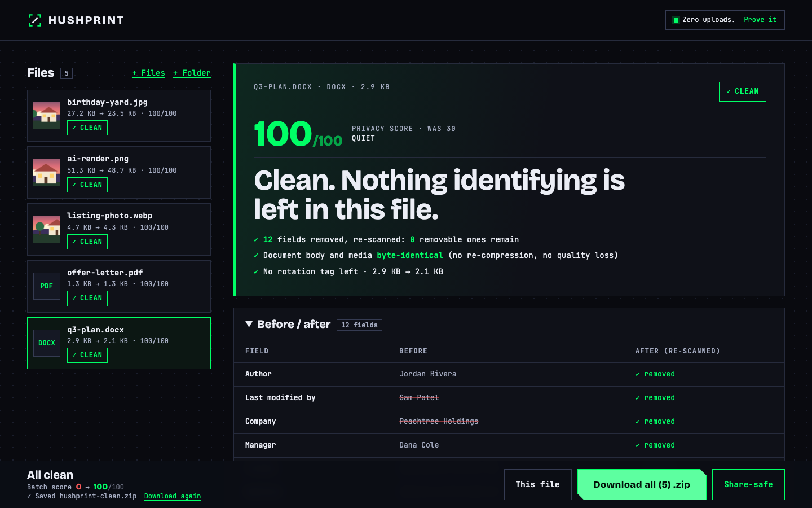

# Hushprint


**Your files talk. Make them hush.** See the GPS spot, author name, device serial and hidden thumbnail inside a photo, PDF, Office file or video, then strip them. In your browser, offline, with nothing uploaded.

**Who it's for:** anyone who posts, sells, emails or submits files and does not want a stranger to learn where they live, who they are or what phone they own.

**Drop · See · Clean.** Drop a file or a whole folder, see exactly what it gives away with a 0 to 100 privacy score, clean it in one tap and check the proof. The page is not even allowed to make a network request.

## Quick start

```bash
npm install
npm run dev          # open http://localhost:5173, click "Try a sample with GPS"
npm test             # 116 tests, including fuzzing
npm run build        # typecheck + production build (strict CSP + offline service worker)
```

Command line, same engine (Node 22.18+):

```bash
node bin/hushprint.mjs scan  photo.jpg report.pdf          # findings + privacy score
node bin/hushprint.mjs clean ./trip --out ./safe           # whole folder, never overwrites
node bin/hushprint.mjs clean ./trip --share-safe           # random output names
```



## Supported formats

| Format | Reads | Removes | How |
|---|---|---|---|
| JPEG | EXIF (GPS, device, serials, thumbnail), XMP, IPTC, comments, data after the image | All of it | Segments dropped, pixels never touched |
| PNG | tEXt/zTXt/iTXt (incl. AI prompts), eXIf, XMP, tIME, data after IEND | All of it | Chunks dropped, IDAT copied byte for byte |
| WebP | EXIF and XMP chunks, data after the RIFF | All of it | Chunks dropped, VP8X flags and RIFF size rewritten |
| HEIC / HEIF | EXIF and XMP items from the ISO-BMFF boxes | **Re-encodes** to JPEG (canvas) | Not lossless: pixels are decoded and saved again, colours go to sRGB. Needs a browser that can open HEIC (Safari). The CLI can scan HEIC but not clean it |
| PDF | Info dictionary, XMP, embedded-photo GPS, earlier saved versions, bytes after `%%EOF` | Info dict and XMP (also Flate-compressed XMP) | Blanked **in place, same file length**, so xref offsets stay valid |
| DOCX / XLSX / PPTX | `docProps` core, app and custom (author, last modified by, company, manager, template, revision, labels), thumbnail, comment and tracked-change authors, Excel saved paths | `docProps` and the thumbnail | Zip rewritten; other parts keep their compressed bytes; entry timestamps reset to 1980 |
| MP4 / MOV | GPS (`©xyz`, QuickTime `ISO6709`), make, model, software, dates, titles, XMP, timed-metadata tracks | Tag boxes and header timestamps | Boxes renamed `free` and zero-filled in place; audio/video samples untouched |

Every clean copy is parsed again with the same engine. The UI shows what was removed, what remains, and whether the content (pixels, pages, media samples) is byte-identical.

## What's new in v2

- **More than photos.** WebP, HEIC, PDF, DOCX/XLSX/PPTX and MP4/MOV, on top of JPEG and PNG.
- **Privacy score** from 0 to 100 per file and per batch (the batch is only as private as its worst file). It is a transparent heuristic: capped penalties per severity, and GPS coordinates cap the score at 25. See [`src/engine/score.ts`](src/engine/score.ts).
- **Share-safe mode**, one tap: strips everything including the rotation tag and renames every file to a random `hp-<12 hex>` name, so the filename cannot leak either.
- **Drag a folder** to batch-clean it, with a progress bar. Subfolders are kept inside the ZIP; unsupported files are skipped and counted.
- **Installable and offline.** A small service worker caches the app shell. It never sees your files.
- **CLI** (`hushprint scan|clean`) on the same engine.
- **Hardened parsers.** Every allocation is capped, decompression bombs are cut off at a few MB, and every parser is fuzzed. Trusted Types is enforced. See [SECURITY.md](SECURITY.md) and [THREAT_MODEL.md](THREAT_MODEL.md).
- **Honest caveats.** Leaks the tool can see but cannot remove losslessly are listed after cleaning ("Partly clean"), never hidden behind a green tick.

## How it works

All of it is hand-written TypeScript in [`src/engine`](src/engine), with no parsing libraries: a JPEG marker walker, PNG and RIFF chunk readers, a TIFF/EXIF reader, an ISO-BMFF box walker (HEIC, MP4), a tolerant PDF object scanner, and a bounded ZIP reader/rewriter.

<details>
<summary>Engine map</summary>

| File | Job |
|---|---|
| `jpeg.ts` `png.ts` `webp.ts` | Container parsers and lossless strippers |
| `tiff.ts` | EXIF reader/writer, loop and bounds guards, work budget |
| `isobmff.ts` `heic.ts` `mp4.ts` | Box walker, HEIC item extraction, video metadata and in-place stripper |
| `pdf.ts` | Object scanner, Info and XMP finder, in-place blanking, stored-zlib blanking for compressed XMP |
| `zip.ts` `office.ts` | Bounded ZIP reader and rewriter, Office properties |
| `analyze.ts` `findings.ts` | Findings, risk text, `analyze()` and `clean()` with verification |
| `score.ts` `names.ts` `limits.ts` | Privacy score, random names, every size cap in one file |

</details>

## Privacy and security

- Files are read with the File API and processed in tab memory. Nothing is stored: no IndexedDB, no localStorage, no cache of your files.
- The page ships `connect-src 'none'`, `default-src 'none'`, no inline script, **Trusted Types enforced**, and no `innerHTML` anywhere in the code (a test fails the build if one appears). File text is only ever rendered as text.
- The service worker has its own tiny policy (`connect-src 'self'`) because it needs `fetch` to fill its cache. It ignores cross-origin requests and never receives file data.
- *Prove it* in the header shows the live policy and tries to send a request; the browser refuses it.
- The production build was exercised in Chromium with the real response headers (`scripts/serve-prod.mjs`): **0 external requests, 0 CSP violations**, offline reload works, and a JPEG whose metadata contains `` and `<script>` renders as plain text.
- Fuzzing covers every parser (mutation, truncation, hostile length fields, decompression bombs) in `tests/fuzz.test.ts`. `npm audit` reports 0 vulnerabilities.

## Honest limits

The five that matter. The full list, with what is and is not protected, is in [THREAT_MODEL.md](THREAT_MODEL.md).

1. **It removes metadata, not what is visible**: faces, street signs, house numbers, text on a page.
2. **HEIC export and baked-in rotation re-encode** the image (lossy, colours go to sRGB). The real canvas path was not exercised for HEIC here; headless Chromium cannot open HEIC.
3. **Some leaks are shown but not removed**: PDF Info inside compressed object streams and earlier saved revisions, tracked-change authors in Office files, per-second GPS tracks in action-cam video. The UI marks such files "Partly clean".
4. **Office output was not opened in Microsoft Office.** It was checked with our own parser, Python's zipfile and macOS `textutil`.
5. **Limits and trust:** files over 256 MB are refused, a batch is capped at 500 files / 1 GB, parsing runs on the main thread, and nothing has been audited by a third party.

## Roadmap

1. Run parsing in a Web Worker so huge batches never block the page.
2. PDF object-stream rewrite (qpdf-style) to clear Info that lives in compressed streams, and annotation authors.
3. Lossless JPEG rotation (DCT block transform) so Share-safe can drop the rotation tag without re-encoding.
4. Web Share Target, so the OS share sheet can hand files straight to Hushprint.
5. AVIF, GIF and TIFF; Office tracked-change cleaning.
6. Optional redaction view for faces and text in the visible image.

## Stack

Vite, React, TypeScript, Vitest. Fonts (Bricolage Grotesque, JetBrains Mono) are bundled locally. MIT licensed.
