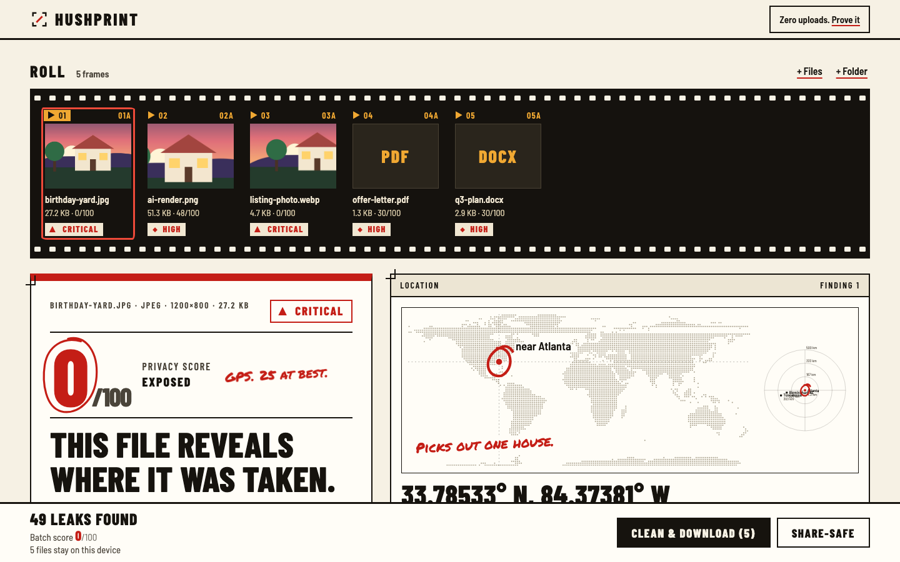

# Hushprint

Shows the hidden metadata in photos, PDFs, Office files and videos (GPS, author, serial numbers, embedded thumbnails) and strips it, entirely in the browser.



## Quick start

```bash
npm install
npm run dev     # http://localhost:5173, then "Try a sample with GPS"
npm test
```

`npm run build` type-checks and builds the production bundle with the CSP and offline service worker. The same engine runs from the command line (Node 22.18+):

```bash
node bin/hushprint.mjs scan photo.jpg report.pdf
node bin/hushprint.mjs clean ./trip --out ./safe
```

## Supported formats

| Format | Handling | Method |
|---|---|---|
| JPEG, PNG, WebP | Stripped losslessly | Metadata segments and chunks dropped; image data copied byte for byte |
| MP4, MOV | Stripped losslessly | Tag boxes renamed `free` and zeroed in place; media samples untouched |
| PDF | Stripped losslessly | Info dictionary and XMP blanked in place at the same length |
| DOCX, XLSX, PPTX | Stripped losslessly | `docProps` and thumbnail removed; other parts keep their compressed bytes |
| HEIC | Re-encoded to JPEG | Browser only, needs a browser that can decode HEIC. The CLI reports it but does not clean it |
| Rotated images in Share-safe mode | Re-encoded | The rotation is baked into the pixels |
| Some PDF and video leaks | Report only | Shown after cleaning as "Partly clean" |

## How it works

- **Hand-written parsers.** JPEG, PNG, RIFF, TIFF/EXIF, ISO-BMFF, PDF and ZIP are read by code in [`src/engine`](src/engine), with no parsing dependencies. Every allocation and loop is bounded by one set of limits in `limits.ts`, and decompression is capped.
- **Lossless means proved.** After cleaning, the image data, pages or media samples are hashed before and after. The UI reports "identical" only when the hashes match.
- **Re-parse verification.** Every clean copy is parsed again with the same engine. Anything still found is listed, not hidden.
- **Fail closed.** The CLI exits non-zero if verification fails, never overwrites input and refuses symlinks and oversized files.
- **No network.** The production page ships `connect-src 'none'` and Trusted Types. A test fails the build if the policy weakens. "Prove it" in the header tries a request and shows the browser refuse it.
- **Fuzzed.** `tests/fuzz.test.ts` feeds every parser mutated, truncated and hostile files: bad length fields, loops, decompression bombs.

## Limits

- It removes metadata, not what is visible: faces, signs, house numbers, text on a page.
- HEIC export and baked-in rotation lose the byte-identical guarantee, and colours go to sRGB.
- PDF Info inside compressed object streams, earlier PDF revisions, tracked-change authors and per-frame video GPS are reported but not removed.
- Office output was checked with our own parser, Python's `zipfile` and `textutil`, not Microsoft Office.
- Files over 256 MB are refused, batches are capped at 500 files or 1 GB, and parsing runs on the main thread.
- No third-party audit.

See [SECURITY.md](SECURITY.md) and [THREAT_MODEL.md](THREAT_MODEL.md).

MIT licensed.
