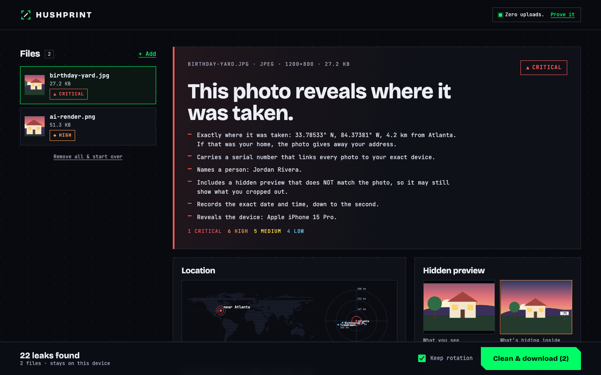
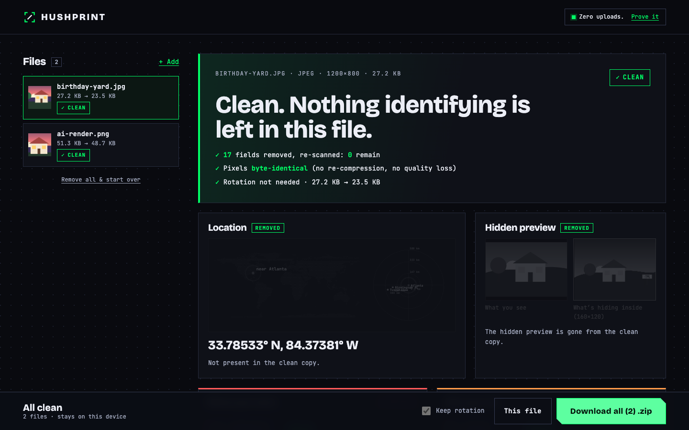

# Hushprint

**Your photos know where you live. Hushprint shows you what they're saying, then makes them hush.**

Drop a photo. See the exact GPS spot, phone model, serial number, timestamp and hidden thumbnail inside it. Wipe all of it in one tap, and prove it worked. Everything runs in your browser. Nothing is uploaded, and the page is not even *allowed* to make a network request.

> **Repo description:** See exactly what hidden data your photos leak (GPS, device serials, hidden thumbnails), then strip it. 100% in-browser, zero uploads, hand-written JPEG/PNG/EXIF/XMP engine.
> **Topics:** `privacy` `exif` `metadata` `gps` `photo-privacy` `exif-remover` `metadata-stripper` `jpeg` `png` `xmp` `client-side` `local-first` `csp` `typescript` `react` `vite`

| What's leaking | After "Clean & download" |
|---|---|
|  |  |

Mobile-first: [empty](docs/mobile-empty.png) / [report](docs/mobile-loaded.png) / [cleaned](docs/mobile-cleaned.png).

## Who it's for

Anyone who posts or sends photos: selling things online, listing a room, sharing pictures of kids, a pet, a new apartment, or a first apartment you do not want a stranger to find. A phone photo can carry coordinates accurate to a few metres. If you took it at home, you just handed over your address. Most people have no idea, and most "remove EXIF" tools either upload your file to a server or silently do something you cannot check.

## What it shows you

- **Where**: GPS latitude/longitude, altitude, heading. Drawn on an offline dot-matrix world map plus a local radar showing the nearest cities, to scale.
- **What and who**: camera/phone make and model, lens, body and lens **serial numbers**, owner name, artist, copyright, face-tag names, photographer fields.
- **When**: capture time, GPS clock, timezone offset, last-modified time.
- **Leftovers**: the **embedded EXIF thumbnail**, shown side by side with the photo (flagged if its shape differs, i.e. it predates your crop), plus bytes hidden after the image ends (the "aCropalypse" class of bug, and hidden second JPEGs).
- **Notes**: captions, keywords, comments, AI-generator prompts saved in PNGs, editing software.

Each finding comes with a severity (critical, high, medium, low), a plain-English reason, and the container it came from (`EXIF GPS`, `XMP`, `IPTC`, `PNG text`...).

## How it works

All of it is hand-written TypeScript in [`src/engine`](src/engine), with no parsing libraries.

| Piece | What it does |
|---|---|
| `jpeg.ts` | Marker-level walker. Handles byte-stuffing, RST markers, progressive scans, EOI. Reads APP1 EXIF, XMP, APP13 IPTC, COM. Rebuilds the file keeping only what is needed to display it. |
| `tiff.ts` | EXIF/TIFF reader (both byte orders, IFD0, Exif, GPS, thumbnail IFD, loop and bounds guards) and a writer used to build test fixtures. |
| `png.ts` | Chunk parser with CRC checks. Reads tEXt/zTXt/iTXt/eXIf/tIME. Keeps only chunks that affect rendering (incl. APNG), drops everything else and anything after IEND. |
| `analyze.ts` | Turns raw tags into findings, severities and the plain-English risk summary. Runs strip, then **re-parses the output** to verify. |
| `zip.ts` | Tiny ZIP writer for "download all". |

**Stripping is lossless.** The pixel stream is never decoded or re-compressed, so there is no quality loss. A CRC over the pixel data before and after proves it (`Pixels byte-identical` in the UI).

**Rotation is preserved.** Phones store "rotate 90 degrees" as an EXIF tag. Instead of deleting it and leaving your photo sideways, Hushprint keeps a single 1-field Orientation tag (toggle with *Keep rotation*).

**Verify-after-strip.** Every clean copy is analysed again with the same engine. The UI reports `fields removed, re-scanned: 0 remain` and shows a before/after table. If anything survives, it says so.

## Privacy, and how to check it

- Files are read with the File API and processed in tab memory. No server exists.
- The production build ships a Content-Security-Policy with **`connect-src 'none'`**: the browser itself blocks every fetch, XHR, WebSocket and beacon. Scripts, styles, fonts and images are same-origin only. No analytics, no CDN fonts, no map tiles.
- *Prove it* in the header opens a panel with the live policy and a button that tries to send a request. The browser refuses it and reports the violated directive.
- Check yourself: DevTools > Network, then clean a photo. Zero requests.
- Playwright run of the full flow (scan, clean, download) recorded **0 external requests and 0 CSP violations**.
- [`vercel.json`](vercel.json) carries the same policy as a response header for hosting (not deployed).

## Honest limits

- **JPEG and PNG only** in this version. HEIC, WebP, PDF and DOCX are not supported (see roadmap). On iPhone: Settings > Camera > Formats > *Most Compatible*, or share as JPEG.
- It removes **metadata**, not what is visible in the picture: faces, street signs, house numbers, reflections.
- Embedded ICC colour profiles are kept so colours stay correct; they hold no personal data.
- Appended extra images (HDR gain maps, motion-photo video) are removed along with other trailing data. The photo still displays, but loses those extras.
- The risk wording is a heuristic. "Reveals where you live" assumes the photo was taken at home; the tool cannot know.
- Nearest-city distances use a small built-in list of ~70 cities, not a full gazetteer.
- Not a forensic guarantee against techniques outside the file itself (sensor noise fingerprints, filename, filesystem timestamps).

## Run it

```bash
npm install
npm run dev          # http://localhost:5173 (no CSP in dev; it is injected in production builds)
npm test             # 25 tests: parsers, strippers, round-trips, fuzzing, zip
npm run build        # typecheck + production build into dist/
npm run preview      # serve the build with the strict CSP
```

Click **Try a sample with GPS** for a planted fake photo (a crop whose hidden thumbnail still shows the mailbox) and a PNG with an AI prompt and leftover bytes. Fixtures are generated in code; no copyrighted images.

Screenshots: `npm run build && npx vite preview --port 4173` then `PLAYWRIGHT_PATH=... node scripts/screenshots.mjs`.

## Tests

`tests/engine.test.ts` builds JPEGs and PNGs programmatically with known metadata and checks:

- EXIF round trips in both byte orders; GPS sign handling; truncated and looping IFDs.
- Findings for GPS, serials, owner, XMP face names, IPTC, comments, mismatched thumbnails, data after EOI/IEND.
- After cleaning: none of the planted strings exist anywhere in the output bytes, re-scan is empty, pixel digest is identical, orientation is kept, cleaning is idempotent, and PNGs still decode with valid CRCs.
- 400 mutated/truncated files never produce anything but a clean parse error.

## Roadmap

1. HEIC/HEIF (in-place neutralise the Exif item) and WebP.
2. PDF (Info dict and XMP) and DOCX/XLSX/PPTX (`docProps`, document thumbnail).
3. CLI sharing the same engine for files on disk.
4. Installable PWA for fully offline use.
5. Optional redaction view for faces and text in the visible image.

## Stack

Vite, React, TypeScript, Vitest. Fonts (Bricolage Grotesque, JetBrains Mono) are bundled locally.
